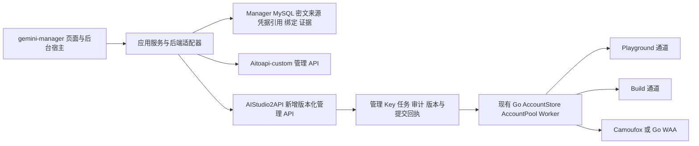

# AIStudio2API 与 Aitoapi-custom 对比及 gemini-manager 接入评估

评估日期：2026 年 10 月 20 日。

AIStudio2API 适合作为 gemini-manager 管理的独立后端，主要价值是 Playground 与 Build 通道、动态模型能力、多媒体接口以及可选的 Go WAA 后端。全面接入需要同时改造 AIStudio2API 的管理接口和 Manager 的后端适配、数据关系与状态展示；当前代码不能仅通过修改服务器地址完成接入。

建议先在 AIStudio2API 服务进程内实现兼容的管理协议，再在 Manager 中增加明确的 AIStudio2API 后端适配。复用现有采集、加密、租约、任务检查点和后台 UI 宿主；新增原生能力面板与必要的绑定关系。Aitoapi-custom 保留现有运行和管理路径，用作并行对照及回退。

## 评估基线与验证范围

| 项目 | 正式目录 | Git 提交 | 工作树依据 |
|---|---|---|---|
| AIStudio2API | `G:\code\gemini30\AIStudio2API` | `00ad27b5947b0feb2f7fc4dde0c0853ac2a54200` | 评估开始时业务代码干净 |
| Aitoapi-custom | `G:\code\gemini30\Aitoapi-custom` | `6517ef44ddb782046486ada7c12b0e5dda4bc70a` | 包含当前既有未提交修改 |
| gemini-manager | `G:\code\gemini30\gemini-manager` | `ef3774d936e0ea060aaea2be032ea2bbd5c4162d` | 包含当前既有未提交修改，不能只按 HEAD 判断集成现状 |

本轮运行 Manager 的 17 个现有 Aitoapi 专项测试模块：187 项通过，0 失败、0 错误、0 跳过，耗时 18.620 秒。另执行 5 个纯内存兼容性探针。没有解锁真实配置、读取真实 Cookie 或 Key，没有生产 API、模型调用、数据库迁移、上传或部署。

AIStudio2API 同一提交此前已完成 118 个 Go 测试条目、`go vet`、Windows 构建、Linux amd64 交叉构建、前端 lint/build 和空账号 Windows 冒烟。这是同一版本已有的离线证据，本轮没有在正式目录重新执行整套 Go 构建；不能据此宣称真实 Google/WAA 认证、Docker 运行、模型成功率或吞吐量已验收。

## 两个服务项目的优缺点

| 维度 | Aitoapi-custom 当前实现 | AIStudio2API 当前实现 | 对 Manager 接入的影响 |
|---|---|---|---|
| 主架构 | Node.js、Express、Playwright，Build App 页面和 WebSocket 转发 | Go，MakerSuite RPC、JSON/protobuf，Playground/Build 及 Build 助手相关实现 | 共享外部契约比移植底层代码更合适 |
| 上游选择 | 当前主要围绕 Build App 代理链 | 可配置 Playground 与 Build，并有 `-build` 助手模型 | 新增通道状态和能力展示；额度可用性须逐账号实测 |
| 模型发现 | 静态目录结合已有探测能力 | 按账号读取模型及权益，保留能力和通道字段 | 应同步账号可用能力，不能把目录存在视作该账号可调用 |
| WAA 与浏览器 | 生产请求依赖浏览器上下文和连接池 | 默认 Camoufox；`WAA_BACKEND=go` 可在生成运行时不启动浏览器 | Go 模式有减少浏览器开销的结构性潜力，实际资源收益尚未测量；登录仍可能使用 Camoufox |
| API 覆盖 | 已有 OpenAI/Gemini/Anthropic 兼容和生成保护 | 除主要协议外，有 Responses 后台/检索/取消/压缩、Files、图像、音频、视频、Live 等实现 | 更适合拓展功能；存在路由不等于所有真实模型场景都通过 |
| 输出完成语义 | 明确区分终止、缺失终止、空回复、仅思考、工具结果等 | 通用消费器检查结束事件，finish-only 仍可被当作完成 | Manager 定向验证要检查真实有效输出，不能只检查 200 或 finish |
| 运维管理接口 | 独立管理 Bearer Key、scope、任务、审计、稳定 ID、版本 | 主要为浏览器控制台 Session 和原生管理 API | Aitoapi 的管理协议是最有价值的复用对象 |
| 凭据管理 | 版本化替换、归档恢复、写入回执、已有 Manager 对接 | 账号目录和原子写入，运行租约，配对导入、重新登录、Chrome 导入 | Go 已有可复用的底层存储和锁，但缺少对外等价的管理语义 |
| 冷却与路由 | 已有按账号/模型的路由、熔断及自愈 | 账号、模型及通道相关冷却和能力选择 | Manager 需要保留 cooldown、权益、登录失败的不同含义 |
| 用量与记录 | JSONL 和进程内查询结构 | SQLite WAL、索引、时间汇总、90 天记录保留；正文保留最近 1000 条 | Go 更适合作为大量请求记录的远端查询源；仍须有界分页接入 |
| 长任务持久性 | 管理任务有持久检查点和中断语义 | Responses 状态容量 256，存在进程内状态；请求账本持久不代表响应状态可恢复 | 不能把生成后台任务当作管理上传任务或承诺重启续跑 |
| 跨平台 | Manager 已有 Windows/macOS 采集与平台适配约束 | 服务可部署多平台；Chrome 设备绑定导入和续签限定 Windows | Linux 服务需要 Manager 重新采集/上传的恢复闭环 |
| 工程维护 | 大量既有安全保护和业务回归；部分核心文件较大 | 模块和类型较完整，但有 WAA VM、指纹、私有 RPC 和大型 runtime 模块 | Go 不自动意味着维护更简单；需承担上游协议变化维护 |
| 仓库许可标识 | CC BY-NC 4.0 | MIT | 两个仓库分别保留各自许可与来源信息 |

AIStudio2API 的 `-build` 模型表示 Build 写代码助手，包含其系统提示词；不能将它等同于普通生成请求使用 Build 代理通道。Manager 的“模型”“通道”“思考参数”应分别建模，避免别名和额度含义混在一起。

依据：[AIStudio2API 模型与通道说明](/G:/code/gemini30/AIStudio2API/README.md:31)、[WAA 装配](/G:/code/gemini30/AIStudio2API/internal/app/waa_backend.go:16)、[公开 API 路由](/G:/code/gemini30/AIStudio2API/internal/api/router.go:43)、[Aitoapi 输出保护](/G:/code/gemini30/Aitoapi-custom/src/core/GenerationResultGuard.js:275)、[Go 用量存储](/G:/code/gemini30/AIStudio2API/internal/requestdb/requestdb.go:21)、[Responses 状态](/G:/code/gemini30/AIStudio2API/internal/api/responses.go:112)。

## gemini-manager 现有 Aitoapi 集成的实际范围

现有实现已覆盖企业子号采集、共享库加密保存、服务器分配上传、覆盖已存在账号、独立模型验证、远端状态同步、过期账号恢复及停用后解绑。Qt 页面依赖应用持有的异步宿主，逐行更新进度；远端写入由无 Qt runner 执行，数据库事务不包围浏览器或 HTTP 操作。

应复用的关键约定包括：

- 来源凭据保存、远端上传提交、模型验证、远端运行状态分别记录。
- 管理 Key 和模型 Key 独立加密保存，不使用控制台密码替代管理 Key。
- 本地槽位 revision、远端 `credentialVersion/stateVersion` 和操作租约共同阻止旧任务覆盖新状态。
- 写入前保存请求身份和幂等键；超时或断线进入待核对，只读取原任务/回执，不盲目重复上传。
- 采集只保存来源；上传默认 `verify:false`；模型验证是独立动作。
- 同步只做 GET。恢复白名单排除手动停用、归档、额度停用和未知状态，并使用原远端 ID 替换。

复用范围也有限制：`AitoapiCaptureService` 当前只接受企业子号；账号持有 Pro/Flash 两组槽位，服务器类型、模型名称和许多 SQL 条件显式限定 Aitoapi。完整接入个人账号、多个同类实例或多模型验证，需要扩展这些边界。

依据：[采集范围](/G:/code/gemini30/gemini-manager/enterprise/aitoapi_capture.py:93)、[服务器与双槽位](/G:/code/gemini30/gemini-manager/enterprise/aitoapi_repository.py:202)、[现有上传与恢复编排](/G:/code/gemini30/gemini-manager/enterprise/aitoapi_runner.py:202)、[远端同步说明](/G:/code/gemini30/gemini-manager/docs/AITOAPI_REMOTE_SYNC.md:1)、[组合根](/G:/code/gemini30/gemini-manager/enterprise/components.py:47)。

## 直接接入的兼容缺口

| 接口或语义 | Manager 当前要求 | AIStudio2API 当前行为 | 全面接入所需改造 |
|---|---|---|---|
| 管理认证 | 独立 Bearer token，scope、撤销、可追责 keyId | 12 小时控制台 Cookie Session；配对 token 是另一套短期导入凭证 | 增管理 Key 与 scope，保留控制台登录 |
| 路由空间 | `/api/manage/v1/...` | `/api/accounts`、`/api/config` 等 | 新增版本化管理路由；原生 API 继续服务现有前端 |
| 成功格式 | `{data:...,requestId}` | 如 `{accounts:[...]}`、`{account:...}` | 转换字段、分页、任务受理和 requestId |
| 错误证明 | 固定错误码/文本、requestId、响应头和 no-store 一致 | 小写错误码，无等价 requestId 证明封装 | 实现兼容错误契约，不能放宽客户端证据核验代替 |
| 账号 ID | 当前只接受字母数字、下划线和连字符 | 规范化邮箱同时作为原生账号 ID/目录名 | 增持久 opaque ID 与原生邮箱 ID 映射，或完整改造新适配器的编码与身份契约 |
| 列表 | `{items,total,offset,limit}`，稳定双扫描核对 | `GET /api/accounts` 一次返回全部账号 | 增有界查询和一致快照；交互列表继续走本地 SQL |
| 凭据上传 | 批量 import，clientRef，verify:false，提交回执 | 配对接口可单个导入 StorageState | 复用 ImportAccountState/AccountStore，外加任务、版本、回执与鉴权 |
| 同账号覆盖 | 原 ID、双版本 CAS 的 credentials replace | 导入重复邮箱报冲突；UpdateAccount 不接收凭据 | 新增原 ID 凭据替换，协调 header/worker/模型缓存 |
| 归档恢复 | 归档保留身份，restore 能读回 | 目前是删除、启停和重新登录 | 新增归档/恢复；删除不能冒充归档 |
| 定向模型验证 | 指定账号和模型，不换号，验证结果绑定版本 | refresh 读取权益和模型目录；无等价管理 test API | 新增独立验证任务，复用内部 AccountID 定向能力 |
| 幂等任务 | 202/taskId、逐项结果、clientRef、重启、中断、取消、审计 | 原生账号操作主要同步返回；请求取消针对生成请求 | 增持久管理任务执行及核对接口 |
| 运行状态 | enabled、archived、expired、disabledReason 和版本 | ready/busy/cooldown/auth_required/unavailable/disabled | 明确映射并保留原生详情，避免把冷却当登录过期 |
| 模型选择 | 当前模型字段正则不允许括号 | 思考后缀如 `gemini-4-argon(high)` | 模型与思考参数分开保存，或使用已验证别名映射 |
| 配置与日志 | Qt 只收安全 DTO，不出现 Cookie/Key/代理秘密 | 原生配置 DTO 含 proxy_api_key、active_proxy_api_key、proxy 等 | 新增面向 Manager 的安全投影与分权写入 |

五个离线探针结果：原生账号响应触发 `INVALID_RESPONSE`；邮箱 ID 触发 `INVALID_ACCOUNT_ID`；原生错误不满足可信错误封装，不能证明写入未受理；括号模型名不符合当前 Manager 正则；Manager 的最小 Cookie 过滤允许 SID-only，不能保证满足 Go 签名所需的三类 Cookie。

依据：[Manager 客户端](/G:/code/gemini30/gemini-manager/enterprise/aitoapi_client.py:85)、[ID 与模型格式约束](/G:/code/gemini30/gemini-manager/enterprise/aitoapi_client.py:19)、[原生管理接口](/G:/code/gemini30/AIStudio2API/internal/api/admin.go:267)、[Session](/G:/code/gemini30/AIStudio2API/internal/api/admin_auth.go:14)、[错误格式](/G:/code/gemini30/AIStudio2API/internal/api/errors.go:280)、[原生账号 ID](/G:/code/gemini30/AIStudio2API/internal/aistudio/accounts.go:3511)。

## 凭据复用与长期恢复

Manager 当前输出 `{cookies,origins,accountName}`。Go 的 StorageState 能保存 cookies/origins 和扩展字段，配对输入则要求外层 `label/locale/timezone/storage_state`。基础结构具备适配条件，转换时应从已核对来源填入 label，保留原有凭据身份边界。

需要处理四个不同问题：

1. Go Signer 要求当前有效的 `SAPISID`、`__Secure-1PAPISID`、`__Secure-3PAPISID`；Manager 的“Google Cookie 非空”校验更宽。上传前应做目标后端专属校验，但不能把离线签名成功当作 Google 认证成功。
2. 原生 ImportAccountState 主要验证结构、签名材料和重复账号；label 或认证扩展中的邮箱不是独立的在线身份证明。应复用 Manager 的可信来源采集，并在定向测试中核对结果归属。
3. 普通 IXBrowser StorageState 不包含 Chrome 的设备绑定 OAuth 续签材料，也不等价于 Camoufox 指纹。指纹字段在配对输入中可选，不应伪造浏览器来源或续签扩展来绕过校验。
4. Chrome 的 DBSC 导入与续签限定 Windows。Linux/macOS/Docker 服务不能因为保存了这些材料就获得等价续签能力。面向 Linux 部署，应提供“Manager 原账号重新采集 → 加密保存 → 原远端 ID 的 CAS 替换 → 显式模型验证”的恢复路径。

来源凭据由 Manager 当前加密存储负责；服务运行时凭据由 Go AccountStore 负责。上传服务应调用 Go 内部写入方法，不远程改 auth 文件，也不由两套进程同时直接维护同一份 Cookie 文件。服务 Cookie 轮换与 Manager 来源版本应分别保留，明确何时使已验证证据失效。

依据：[Manager 过滤器](/G:/code/gemini30/gemini-manager/enterprise/aitoapi_storage_state.py:16)、[配对输入](/G:/code/gemini30/AIStudio2API/internal/api/pairing.go:25)、[导入实现](/G:/code/gemini30/AIStudio2API/internal/app/admin.go:302)、[签名条件](/G:/code/gemini30/AIStudio2API/internal/aistudio/signer.go:61)、[非 Windows 导入限制](/G:/code/gemini30/AIStudio2API/internal/chromeauth/platform_other.go:7)。

## 推荐接入架构

管理兼容层放在 Go 服务内部，可以在真实写入锁和运行租约内核对版本，同时让原生前端写入遵循相同的版本规则。纯 HTTP 外挂桥只能看到外部结果；当原生 UI 或自动刷新同时修改账号时，桥自身保存的版本不足以保证 CAS。

外部桥可用于受限 PoC，例如明确只有一个写入者、仅验证初次导入；不宜据此宣称已实现全面接入。也不建议把两套生成内核合并成一个项目。

### AIStudio2API 改造范围

- 在 `internal/api` 增管理 Key、scope、兼容封装及 `/api/manage/v1` 路由；原生控制台 API 保留。
- 通过现有 AccountStore、AccountPool、发布/运行租约实现 import、replace、enable/disable、archive/restore；增加 opaque ID 映射和管理版本元数据。
- 在原生 UI、管理 API、凭据刷新涉及同一状态时复用同一版本和写入协调，避免旁路写入。
- 管理任务有持久的幂等身份、逐项结果、上传提交回执、审计和取消。重启不得重放结果未知的模型或写入动作。
- Cookie 文件与任务数据库之间需要可恢复提交日志或等价协议。单独提交一个 SQLite 事务，不能证明外部凭据文件与回执一起原子落盘。
- 新增定向模型验证，使用内部 AccountID/租约固定账号；明确请求模型、最终通道、Google 结果、当前凭据版本、有效输出及取消结果。普通 refresh 仍仅表示权益/目录刷新。
- 提供能力声明及安全状态查询，覆盖管理协议版本、定向验证、通道、设置、冷却、用量等；能力不足时显示具体限制。

### gemini-manager 改造范围

- 在现有组合根与服务器 UI 中增加明确的 AIStudio2API 后端标识和适配器；不通过伪装服务器、关闭错误核验或存控制台 Session 来接入。
- 提取确实共用的管理 HTTP、安全 DTO、任务恢复和凭据采集协作接口，保留现有 Aitoapi runner 和仓储的兼容入口，避免重写全项目服务器模块。
- 企业基本流程可先复用 Pro/Flash 业务预设。全面接入最终应支持“实例—来源账号—远端账号”和“账号—模型—通道—验证证据”关系；当前两个 Aitoapi 槽位不足以同时表达多个后端实例和全部模型。
- 新关系使用窄仓储和显式版本迁移。旧 Aitoapi 槽位继续由原 owner 管理；新增关系不复制或改变旧凭据 AAD，不批量覆盖现有密文或共享库记录。
- 如纳入个人账号，使用个人 read/credential/window ports 和 scope-aware 身份，不能将个人 account_id 当企业 account_id 使用。首期与现有 Aitoapi 对齐时，可明确限定企业子号。
- 新面板复用 Qt 后台宿主、queued 信号、取消和受影响行更新。所有交互列表在 SQL 中过滤、排序、计数和分页；全量同步、导出使用独立有界后台批次。
- 继续使用 `config/system.yaml`、`config/secrets.enc` 和既有数据库行密文，不新增 `.env`、OS keyring 或机器级配置来源。迁移单独执行，启动与页面加载不执行 DDL；验证不使用 GitHub Actions。

## 全面接入的功能范围

| 功能 | 对齐 Aitoapi 的基础闭环 | AIStudio2API 的扩展目标 |
|---|---|---|
| 服务器登记 | 地址、独立管理/模型 Key、连通性和能力检查 | 后端类型、协议版本、实例身份 |
| 账号来源 | 企业子号采集、加密来源版本、批量上传 | 可选个人账号适配，不能默认算作现有能力 |
| 账号生命周期 | 导入、覆盖、启停、归档、恢复、解绑、未知结果核对 | 原生配置/代理映射，保留稳定远端身份 |
| 模型验证 | 指定账号和模型，上传/验证独立 | 按模型和通道保留结果、权益和失败阶段 |
| 通道和权益 | 基础状态 | Playground/Build 冷却、权益、可用模型与通道能力 |
| 模型选择 | 保留 Pro/Flash 业务预设 | 动态目录、思考参数、别名和 `-build` 助手区别 |
| 运行配置 | 安全查询与明确写入 | WAA 后端、worker 容量、并发、代理、路由策略、重启需求 |
| 请求与用量 | 后台分页查询和安全导出 | 请求取消、通道/模型/账号汇总和历史趋势 |
| 多媒体与长任务 | 与账号和实例绑定的能力说明 | 图像、音频、视频、Files、Responses、Live 的独立验收与任务归属 |
| 跨平台恢复 | Windows/macOS Manager 行为一致 | Linux 服务过期后经 Manager 恢复；不假设 Windows DBSC 可跨平台续签 |

Manager 负责账号和控制管理。文本、音视频和 Live 的模型流量继续直接由调用方访问 Go 服务，避免把桌面 Manager 变成新的数据转发瓶颈。若需在 Manager 内增加体验或诊断按钮，应单独限定调用预算、账号、模型与输出，不随普通状态同步调用模型。

## 主要风险与修复顺序

| 优先级 | 问题 | 影响与处理 |
|---|---|---|
| P0 | 管理认证、版本、幂等和写入回执缺口 | 进入批量生产管理前补齐。不能在适配层凭当前版本拼造历史上传回执 |
| P0 | 身份与定向验证 | 三 Cookie 可签名不证明声明邮箱及模型成功；测试应固定账号，并检查有效内容与版本归属 |
| P0 | 远程媒体 DNS 重绑定边界 | `remote_media.go` 先解析校验，HTTP transport 再解析，未固定已验证 IP；此前同提交独立探针已复现。应把校验与拨号绑定，覆盖重定向 |
| P1 | 严格工具 Schema 编译失败被忽略 | `tool_contract.go:77` 编译错误时不返回错误，可能丢失 strict 校验。进入工具场景前修复并回归 |
| P1 | 空回复及仅思考回复被判成功 | 定向测试不能只采信 finish；补齐通用输出判定，避免“已验证”误报 |
| P1 | 冷却被当作登录过期 | 可能触发无效重采、覆盖或错误启用。保留原生状态，明确 auth_required 的判据与恢复白名单 |
| P1 | 原生配置响应含敏感字段 | 管理 Key/模型 Key、代理凭据不得进入 Qt 信号、批次结果或日志；按生产源头输出安全 DTO |
| P1 | 兼容层版本与原生 UI/自动刷新脱节 | 所有相关写入复用 Go 内部版本与租约；内存外挂版本不能提供并发保护 |
| P2 | 性能与资源收益未经同条件对照 | 同账号、同模型、同代理、同并发、同输出限制下比较首 token、总耗时、RSS、CPU、错误和重复请求 |

Aitoapi-custom 自身也保留已知改进项：内部 WebSocket 若可被非可信客户端访问，当前连接登记缺少对等端鉴权；非生成请求的原始正文采集缺少同等全局限制，模型鉴权在收集之后。此前独立探针已复现，本轮复核对应代码仍在。这些问题需要在各自边界修复，不能用现有 Manager 集成成熟推导出服务所有边界已完善。

依据：[远程媒体](/G:/code/gemini30/AIStudio2API/internal/api/remote_media.go:57)、[工具 Schema](/G:/code/gemini30/AIStudio2API/internal/aistudio/tool_contract.go:77)、[输出消费器](/G:/code/gemini30/AIStudio2API/internal/api/generate.go:193)、[敏感配置字段](/G:/code/gemini30/AIStudio2API/internal/api/admin.go:205)、[Aitoapi 原始正文与 WS](/G:/code/gemini30/Aitoapi-custom/src/core/ProxyServerSystem.js:490)。

## 分阶段实施与验收

| 阶段 | 交付 | 退出条件 |
|---|---|---|
| 1 管理协议与安全基础 | Go 管理 Key、ID 映射、版本、持久任务、提交回执、错误契约、分页 | Manager 客户端契约通过；断线/重启/重复键/不同正文/CAS 冲突和已提交取消均有确定结果 |
| 2 企业账号闭环 | 采集复用、加密来源、导入/原 ID 替换、独立验证、同步恢复、解绑；Manager 新后端入口 | 新建与已有账号均闭环；上传零模型调用；未知结果不重传；手动停用不被自动覆盖 |
| 3 原生能力整合 | 动态模型、通道冷却、WAA/并发/代理配置、分页请求和用量、多个模型验证证据 | 界面状态与远端含义一致，敏感字段不进入展示 DTO，所有列表有界 |
| 4 跨平台和真实验收 | Windows/macOS Manager、Linux 服务、受控账号与同条件性能对照 | 隔离 MySQL 并发/迁移通过；真实定向生成、过期恢复、取消及回退有记录；各多媒体能力单独验收 |

按单名熟悉三个项目的开发者估算：企业基础闭环约 10–18 人日，补齐原生能力与双平台/隔离库/受控账号验收约 8–15 人日。合计约 18–33 人日，是工作量推断，不是交付承诺；个人账号、复杂视频/Live UI、WAA 上游变化和缺少测试账号会增加范围。单独做配对导入 PoC 的时间不能用来代表全面接入。

首个可实施批次应完成管理协议和故障恢复基础，再接企业账号闭环。真实验证需要按账号、模型、通道和次数单独确定范围；性能结论只依据同条件实测。

## 本轮证据与代码入口

- [187 项 Manager 回归结果](/G:/code/gemini30/gemini-manager/runtime/devices/codex-aistudio2api-assessment-20261020/manager-tests.json)
- [Manager 回归日志](/G:/code/gemini30/gemini-manager/runtime/devices/codex-aistudio2api-assessment-20261020/manager-tests.log)
- [5 项兼容性探针](/G:/code/gemini30/gemini-manager/runtime/devices/codex-aistudio2api-assessment-20261020/compatibility-probes.json)
- [同提交 AIStudio2API 既有构建与独立探针证据](/G:/code/gemini30/Aitoapi-custom/tmp/AIStudio2API-evaluation-20261020/.evaluation-cache/checks/assessment.json)
- [Aitoapi 管理协议](/G:/code/gemini30/Aitoapi-custom/docs/management-api-contract.md:32)
- [Manager 架构与数据归属](/G:/code/gemini30/gemini-manager/docs/LLM_PROJECT_GUIDE.md:183)

本轮交付为评估与离线验证，没有实施管理兼容层或修改三个项目的业务代码。
